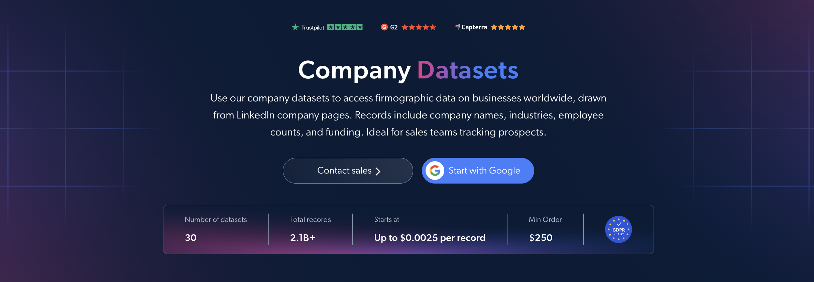

# 增强型公司信息数据集样本

<h2>包含 1,000 条增强公司记录的示例数据集</h2>

<a href="https://www.bright.cn/cp/datasets/browse/gd_m3fl0mwzmfpfn4cw4">
   
</a>

包含 1,000 条公司记录的公司信息增强数据集示例。该数据集使用 <b>Bright Data API</b> 提取。

<h2>数据集中包含的部分数据点：</h2>

* ```url```：与公司记录关联的 URL
* ```id_lc```：公司标识符
* ```name_lc```：公司名称
* ```country_code_lc```：与公司关联的国家/地区代码
* ```locations_lc```：公司所在地
* ```followers_lc```：LinkedIn 关注者数量
* ```employees_in_linkedin_lc```：LinkedIn 上与公司关联的员工人数
* ```about_lc```：公司概况和描述

以及更多数据点。

这是“公司信息增强数据集”的示例子集，完整数据集包含超过 <b>30,400,000 条公司记录</b>。

可用的数据集文件格式：<b>JSON、NDJSON、JSON Lines、CSV 或 Parquet。还可选择将文件压缩为 .gz 格式</b>。

数据集交付方式选项：<b>电子邮件、API 下载、Webhook、Amazon S3、Google Cloud Storage、Google Cloud PubSub、Microsoft Azure、Snowflake、SFTP</b>。

更新频率：<b>单次、每日、每周、每月、每季度、每半年或自定义频率</b>。

除提取的数据点外，还可提供数据增强服务：<b>按需提供。</b>

<b>[获取完整的公司信息增强数据集](https://www.bright.cn/cp/datasets/browse/gd_m3fl0mwzmfpfn4cw4)</b>。

<a href="https://www.bright.cn/cp/datasets/browse/gd_m3fl0mwzmfpfn4cw4">
</a>

<h2>公司信息增强数据集有哪些使用场景？</h2>

<h3>1. 公司研究与竞争对手分析</h3>
企业使用增强的公司记录来研究组织、了解其业务活动并分析其地理分布。比较公司描述、所在地和 LinkedIn 员工人数，有助于识别相关竞争对手，更清晰地了解市场。

<h3>2. 客户发现与 CRM 数据增强</h3>
销售和业务拓展团队使用公司名称、描述和所在地来识别相关客户，并为现有 CRM 记录补充背景信息。公司标识符和来源 URL 有助于匹配记录，并帮助团队整理客户研究信息。

<h3>3. 员工规模与公司影响力追踪</h3>
分析师可以比较不同公司的 LinkedIn 员工人数和关注者数量。通过定期更新数据集，他们可以追踪 LinkedIn 上员工规模和公司影响力的变化，为市场研究和客户优先级排序提供支持。

<h2>为学术研究人员和 NGO 免费提供网页爬虫工具及数据集</h2>

Bright Initiative 向顶尖学术院系和研究人员，以及致力于推动各类环境与社会事业的 NGO 和 NPO，开放 Bright Data 的 <b>[网页爬虫工具 API](https://www.bright.cn/products/web-scraper)</b> 和 <b>[即用型数据集](https://www.bright.cn/products/datasets)</b>。你可以在<b>[此处](https://brightinitiative.com)</b>提交申请。
